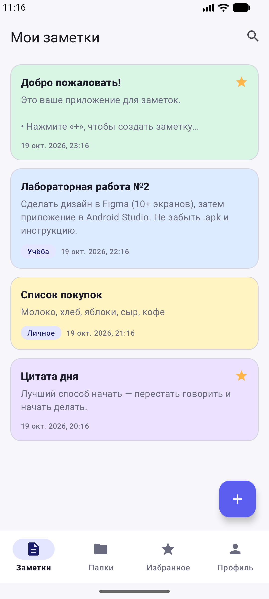
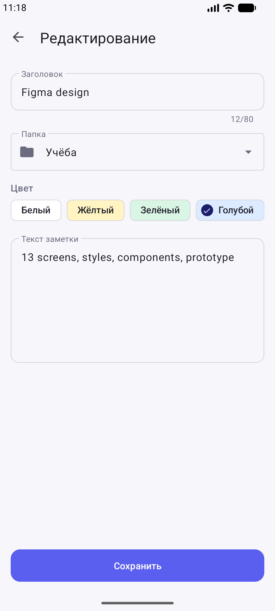
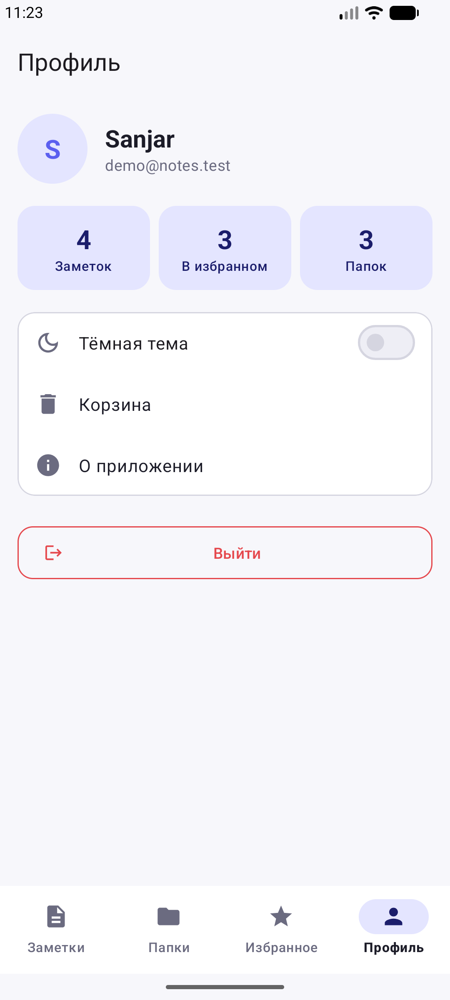
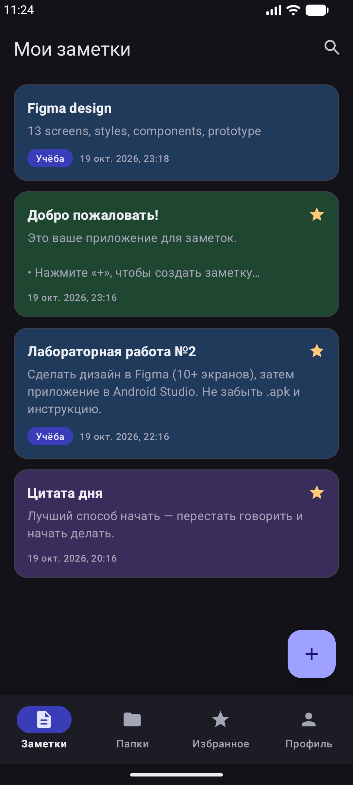

# Заметки — Android-приложение (Лабораторная работа №2)

Простое приложение для заметок на Kotlin: регистрация и вход, заметки с цветами и папками, избранное, поиск, корзина, профиль и тёмная тема. Все данные хранятся локально в SQLite и сохраняются между запусками.

| Главный экран | Редактор | Профиль | Тёмная тема |
|---|---|---|---|
|  |  |  |  |

## Готовый файл для установки

`Notes.apk` можно скачать на вкладке **Releases** этого репозитория (debug-сборка, Android 8.0+).

## Дизайн в Figma

- **Макет:** https://www.figma.com/design/RCRHfh7HqOGxG3LL9T1rXa/
- **Интерактивный прототип:** https://www.figma.com/proto/RCRHfh7HqOGxG3LL9T1rXa/?node-id=1-203&starting-point-node-id=1%3A203&scaling=scale-down

В файле 4 страницы: обложка, стили (15 цветов и 6 текстовых стилей), компоненты с вариантами (Button, Text Field, Color Chip, Note Card, Folder Card, FAB) и 25 макетов экранов с состояниями, связанные 86 переходами прототипа. Макет построен плагином из папки `figma-plugin/` (Figma Desktop → Plugins → Development → Import plugin from manifest).

**Установка на телефон:** скопируйте `Notes.apk` на телефон, откройте файл и разрешите установку из неизвестных источников.

**Установка на эмулятор:** перетащите `Notes.apk` мышкой в окно эмулятора или выполните:

```bash
adb install -r Notes.apk
```

## Запуск из Android Studio

1. **File → Open** и выберите папку `NotesApp`.
2. Дождитесь окончания Gradle Sync (в первый раз скачиваются библиотеки, это занимает несколько минут).
3. Выберите эмулятор (например, `Medium Phone API 37`) и нажмите **Run ▶**.

Сборка .apk вручную: **Build → Generate App Bundles or APKs → Generate APKs**. Готовый файл появится в `app/build/outputs/apk/debug/app-debug.apk`.

Или из терминала:

```bash
gradlew.bat assembleDebug
```

## Как пользоваться

1. При первом запуске нажмите **«Нет аккаунта? Зарегистрироваться»** и введите имя, email и пароль (минимум 6 символов). Можно взять тестовый аккаунт: `demo@notes.test` / `demo123`.
2. После регистрации появятся демо-заметки и три папки: «Учёба», «Личное», «Идеи».
3. **«+»** создаёт заметку: введите заголовок и текст, выберите папку и цвет, нажмите «Сохранить».
4. Нажатие на заметку открывает её. Вверху есть кнопки: ★ (избранное), ✎ (изменить), 🗑 (в корзину).
5. **🔍** на главном экране открывает поиск по заголовку и тексту.
6. Нижнее меню: **Заметки · Папки · Избранное · Профиль**.
7. **Папки**: «+» создаёт папку, долгое нажатие удаляет её.
8. **Профиль**: статистика, переключатель тёмной темы, корзина (восстановить или удалить навсегда), «О приложении» и выход.

## Экраны (13)

| № | Экран | Класс |
|---|-------|-------|
| 1 | Заставка | `ui/auth/SplashFragment` |
| 2 | Вход | `ui/auth/LoginFragment` |
| 3 | Регистрация | `ui/auth/RegisterFragment` |
| 4 | Мои заметки (главный) | `ui/notes/NotesFragment` |
| 5 | Создание и редактирование заметки | `ui/notes/NoteEditFragment` |
| 6 | Просмотр заметки | `ui/notes/NoteDetailFragment` |
| 7 | Поиск | `ui/search/SearchFragment` |
| 8 | Папки | `ui/folders/FoldersFragment` |
| 9 | Заметки в папке | `ui/notes/FolderNotesFragment` |
| 10 | Избранное | `ui/notes/FavoritesFragment` |
| 11 | Корзина | `ui/notes/TrashFragment` |
| 12 | Профиль и настройки | `ui/profile/ProfileFragment` |
| 13 | О приложении | `ui/profile/AboutFragment` |

Скриншоты всех экранов лежат в папке `screenshots/`.

## Архитектура

MVVM: **View** (Fragment + ViewBinding) → **ViewModel** (`StateFlow`) → **Repository** → **SQLite**.

```
app/src/main/java/com/example/notes/
├── NotesApp.kt            — Application, создаёт базу и репозитории
├── MainActivity.kt        — единственная Activity: Toolbar, NavHost, BottomNavigationView
├── data/
│   ├── NotesDbHelper.kt   — SQLiteOpenHelper: таблицы users, folders, notes
│   ├── NotesRepository.kt — заметки, папки, статистика (Flow)
│   ├── UserRepository.kt  — регистрация и вход (пароль хранится как SHA-256)
│   ├── SessionManager.kt  — SharedPreferences: текущий пользователь, тема
│   └── Models.kt
└── ui/                    — фрагменты и ViewModel по экранам
```

- **Навигация:** Navigation Component (`res/navigation/nav_graph.xml`) и `BottomNavigationView`.
- **Хранение данных:** SQLite (заметки, папки, пользователи) и SharedPreferences (сессия, тема).
- **Реактивность:** репозиторий отдаёт `Flow`, который перечитывает базу после каждого изменения. ViewModel превращает его в `StateFlow`, а фрагменты подписываются через `repeatOnLifecycle`.
- **Состояния:** пустые списки, ошибки в полях ввода, выбранный цвет и папка, нажатые кнопки (ripple).

**Технологии:** Kotlin, AGP 9.4, Gradle 9.8, compileSdk 37, minSdk 26, Material 3, AndroidX Navigation, Lifecycle (ViewModel, StateFlow).
